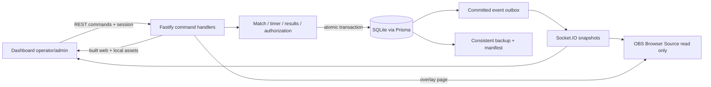

# Arsitektur Sistem Lokal

## Tujuan, Cakupan, dan Status

Menjabarkan R-01–R-17 dan Q-01/04–09/11 dari [PRD](../01-product/PRD.md) menjadi batas modul, aliran data, dan deployment. Seluruh desain di dokumen ini **[PROPOSED]**, kecuali kebutuhan lokal/offline dan integritas yang dikonfirmasi. Repository baru mempunyai template web dan manifest server; diagram berikut adalah target, bukan sistem berjalan.

## Struktur dan Tanggung Jawab

| Lokasi target | Kepemilikan / larangan |
|---|---|
| `apps/web` | Dashboard admin/operator, state presentasi, formulir, preview, halaman overlay. Tidak menjadi otoritas waktu/hasil. |
| `apps/server` / identity | Akun, role, sesi lokal, izin aksi; OBS tidak memperoleh sesi operator. |
| server / tournament | Kategori, grup, tim, jadwal, validasi keanggotaan. Tidak menghitung kelolosan. |
| server / match-control | Aggregate match, verifikasi, fase, segmen, gol, hasil/revisi, lock arena. |
| server / timer | Clock monotonic, persistensi checkpoint, expiry dan rekonsiliasi restart. |
| server / persistence | Transaksi SQLite, migrasi, audit, idempotency, outbox, health storage. |
| server / broadcast | Proyeksi publik tersaring, mode tayangan, snapshot/reconnect. |
| server / operations | Backup/restore terkontrol dan pemeriksaan kesiapan. |
| `packages/shared` | Skema Zod DTO, enum/status dan tipe kontrak; tanpa akses DB, sesi rahasia, atau dependensi UI. |

Modul tidak harus menjadi layanan/proses terpisah. Satu proses backend menyederhanakan operasi; batas modul menjaga kegagalan tampilan tidak merusak penulisan pertandingan. Batas transaksi dan invariant ada di [DATA_MODEL](DATA_MODEL.md), transisi di [STATE_MACHINE](STATE_MACHINE.md).

## Aliran Perintah dan Konsistensi

1. UI membaca snapshot persisten, menampilkan `matchVersion`/`arenaVersion`, lalu mengirim perintah dengan idempotency key. UI tidak menaikkan gol atau menetapkan hasil sebagai fakta sebelum server mengakui commit.
2. Server memeriksa sesi/role, validasi Zod, deduplikasi, versi dan transisi. Satu transaksi memutakhirkan state, version, audit, hasil operasi, dan outbox. Kegagalan membatalkan semuanya.
3. Respons sukses berarti commit selesai. Worker outbox mengirim snapshot/revision setelah commit; kegagalan pengiriman tidak membatalkan commit. Pengiriman boleh berulang; klien mengabaikan revision lama/duplikat.
4. Reconnect selalu menarik snapshot penuh. Putus saat respons: query hasil operation key, lalu snapshot terbaru. Jangan mengirim ulang sebagai aksi baru ketika hasil lama belum diketahui.
5. Tick timer untuk rendering bukan mutasi DB per frame; checkpoint internal terpisah dari versi perintah. Expiry yang terlambat diproses tetap menghasilkan 00:00, tanpa finalisasi otomatis.

Baseline satu arena/channel (D-03/12 belum disahkan). Pemilihan match serta penggantian broadcast memakai `arenaVersion` agar dua tab tidak mengaktifkan dua match. Perubahan match memakai `matchVersion`. Command yang menyentuh keduanya membandingkan keduanya dalam transaksi yang sama. Snapshot gabungan memiliki `broadcastRevision` global untuk urutan publik. Setelah restore, `runtimeId` baru memaksa klien membuang cache/revision lama.

## Development dan Produksi

Development dapat memakai Vite dan Fastify terpisah; port/proxy/CORS baru ditentukan saat runtime dibuat. Semua perintah aktual ada di [README](../../README.md).

Target produksi: satu server Node/Fastify melayani `apps/web/dist`, endpoint `/api`, `/socket.io`, serta `/overlay/main`. Route `/api`/socket tidak boleh jatuh ke fallback HTML SPA. Aset hasil build lokal, termasuk font, ikon, library, tidak bergantung CDN. Halaman dashboard `/operator`, `/admin` dan overlay adalah route **rencana**; belum tersedia.

Bind awal `127.0.0.1`; port target `3000` adalah usulan yang harus dimasukkan manifest rilis. Jangan bind ke LAN tanpa review sesi, firewall, dan risiko baca siaran. Plugin static Fastify dan Socket.IO client belum dipasang. Supervisor/launcher lokal, Node runtime yang diuji, direktori data absolut di luar folder build, health check, serta shutdown terkontrol harus dikemas bersama rilis. Tidak ada script produksi sekarang; runbook tidak boleh menyuruh panitia menjalankan script khayalan.

Tradeoff: satu server memudahkan startup/offline dan satu origin, tetapi satu proses/komputer menjadi titik kegagalan bersama. Mitigasi: checkpoint, backup di media lain, launcher teruji, UPS bila tersedia, dan lembar manual. Web preview/Vite dev bukan layanan produksi.

## OBS dan Isolasi Kegagalan

Browser Source hanya mengambil halaman dan proyeksi publik: nama, kategori, fase publik, segmen, waktu, gol, hasil yang sudah resmi, mode tampilan. Akun, verifikasi rinci, alasan override, dan audit tidak disiarkan. Koneksi OBS mempunyai heartbeat sendiri; preview dashboard bukan bukti OBS menerima state.

Mode Waiting darurat disimpan sebagai pilihan tayangan; tidak mengubah match/timer. Jika koneksi server putus, tombol Waiting tidak bisa diandalkan: petugas OBS menyembunyikan source. Overlay mendeteksi putus heartbeat maupun selisih revision menurut protokol BC di bawah; data basi gagal resync dalam 3 detik menghasilkan pesan netral dan menghentikan extrapolasi. Reconnect menghapus match lama sebelum merender snapshot baru secara atomik. Tidak diperlukan kendali scene OBS melalui API/plugin.

| Kegagalan | Isolasi dan pemulihan |
|---|---|
| OBS/browser refresh | Server tetap berjalan; snapshot penuh saat terhubung kembali |
| Server kill/restart | Semua timer RUNNING menjadi RECOVERY_REQUIRED; operator rekonsiliasi |
| DB gagal/disk penuh | StorageHealth DEGRADED; mutasi bisnis diblok, observasi volatile terlabel, safe display; kembali melalui RECOVERY_PENDING tanpa auto-resume |
| Outbox tertunda | Persistensi tetap sah; tampilkan status siaran tertinggal dan resync |
| Daya putus | Tidak menjamin RPO nol; periksa DB dan checkpoint, pulihkan dari backup bila perlu |
| Konflik tab/operator | Satu versi menang; 409 meminta review state terbaru |

## Validasi dan Keputusan Terbuka

Uji [AC-11/13–20/22–27](../03-quality/ACCEPTANCE_CRITERIA.md). Batas waktu, hardware, checkpoint, dan kapasitas harus diukur. [NEEDS CONFIRMATION] D-03/12/14/15: jumlah arena, channel, ambang penerimaan, dan kebijakan operasi. Dasar keputusan di [ADR lokal](../04-decisions/0001-local-first.md) dan [ADR stack](../04-decisions/0002-tech-stack.md).

## Protokol Kemutakhiran Siaran — BC (H-04)

**[PROPOSED]** BC-01–BC-05 menjadi sumber aturan sinkronisasi R-09/Q-12. CONNECTED hanya menyatakan heartbeat diterima; SYNCHRONIZED menyatakan state yang dirender cocok dengan versi server yang telah diamati.

- **BC-01:** Server mengirim heartbeat independen worker outbox setiap 1 detik: runtimeId, committedBroadcastRevision dari state DB committed (atau cache commit yang diperbarui dalam jalur commit), storageHealth. Jangan mengambil revision dari `lastDispatched`. Jika pembacaan otoritas gagal, tandai DEGRADED; heartbeat tidak boleh mengaku HEALTHY berdasarkan cache tak terverifikasi. Broadcast revision hanya untuk perubahan proyeksi publik; command administrasi privat tidak membuat gap siaran yang tak bermakna.
- **BC-02:** Masing-masing consumer mencatat lastReceivedRevision, lastRenderedRevision, lastHeartbeatRevision, waktu heartbeat/timer.sync/render, timerGeneration dan syncSeq. Identitas runtime dipastikan handshake/full snapshot otoritatif. State publik diterapkan atomik, baru render diakui. Preview dan OBS menggunakan clientInstanceId/clientRole terpisah; ack preview tidak menyehatkan OBS.
- **BC-03:** Jika lastRenderedRevision < revision committed yang diamati, tampilkan CONNECTED / SYNCING dan mulai satu deadline 3 detik sejak mismatch pertama yang belum teratasi. Jangan memperpanjang deadline hanya karena heartbeat atau revision baru datang. Setelah mismatch 1 detik, atau gap/out-of-order yang tak dapat diselesaikan, wajib fetch full snapshot secara langsung melalui GET `/broadcast/main` (bukan outbox). Response no-store menyertakan runtime/revision/timer snapshot. Gagal memuat atau merender state yang setidaknya mencapai revision mismatch awal dalam 3 detik →STALE / safe display. Jika tertinggal lagi karena commit berikut, deadline baru hanya setelah mismatch sebelumnya benar-benar ditutup.
- **BC-04:** Timer memerlukan timer.sync/generation yang mutakhir meskipun broadcastRevision tidak berubah setiap tick. Tidak menerima sync valid selama 3 detik pada timer RUNNING →STALE, meskipun heartbeat tetap masuk. Render error juga tidak diakui sebagai sukses. Storage DEGRADED/RECOVERY_PENDING memicu safe display saat notifikasi, tidak menunggu clock lokal terus berjalan. Putus heartbeat 3 detik →DISCONNECTED + safe display. Safe display menyembunyikan countdown/skor yang diklaim live dan menampilkan pesan netral; data diagnostik terakhir boleh ada di dashboard dengan label basi, bukan pada tayangan kompetisi.
- **BC-05:** Keluar safe display hanya sesudah full snapshot otoritatif runtime saat ini berhasil dirender, storage HEALTHY, dan timer sync valid bila diperlukan; tidak cukup menerima heartbeat. Dashboard menampilkan server CONNECTED, OBS SYNCHRONIZED/SYNCING/STALE/DISCONNECTED/UNKNOWN, revision yang dirender vs server, dan umur ack. OBS ack tidak diterima ≥3 detik →UNKNOWN/STALE, bukan sehat karena preview; ack heartbeat consumer boleh dikirim tiap 1 detik walau revision tetap. Snapshot recovery timer boleh dirender sebagai informasi pemulihan netral, bukan countdown live.

BC tidak mengubah hasil/timer match. Deadline 1/3 detik adalah usulan teknis terukur D-14; acceptance AC-31 menguji outbox macet tetapi heartbeat sehat, timer.sync terhenti, snapshot gagal, render gagal, dua consumer berbeda, dan pemulihan. Q-01 tetap mengukur p95 commit-ke-render, bukan hanya heartbeat.

## Batas Recovery dan Jalur Historis

StorageHealth mengikuti ST [TIMER_SPEC](TIMER_SPEC.md). Ledger OP, GoalIntent dan StartAuthorization adalah modul kontrol command server; store browser hanya metadata pending/presentasi. Backup/recovery mengikuti [RUNBOOK](../03-quality/RUNBOOK.md). Maintenance memastikan seluruh penulis berhenti/terfence secara fisik; durable RUNNING pada file backup tidak mencegah restore. Sesudah restore, runtime/storage epoch baru dan rekonsiliasi berlaku sebelum operasi normal. Impor historis REC [API](API_CONTRACT.md) tidak mengambil arena, menjalankan countdown, atau menyiarkan ulang pertandingan lampau. Rilis tetap tanpa Vite/server eksternal.
